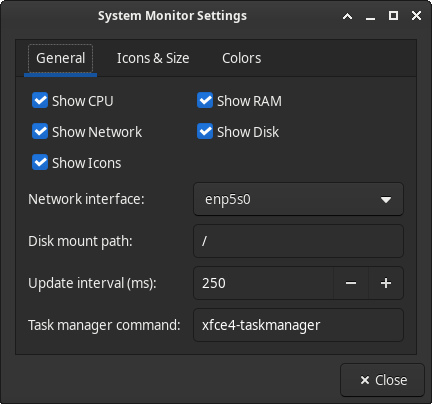
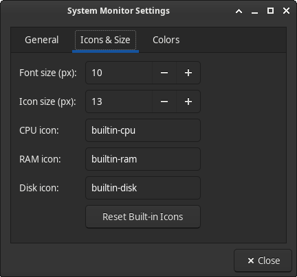
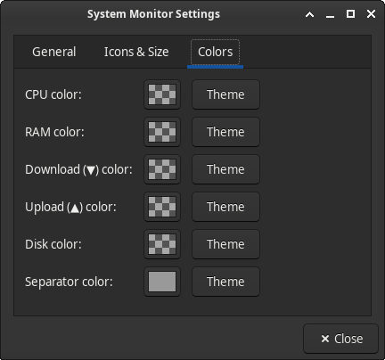

<div align="center">

# xfce4-system-monitor-plugin

Minimal single-row XFCE 4 panel monitor for **CPU**, **RAM**, **Network**, and **Disk**.

<br>


</div>

---

## Highlights

- **Zero-jitter layout** — Tabular numerals and symmetric spacing keep neighboring panel items locked in place.
- **250 ms real-time polling** — Pre-opened `/proc` file descriptors with a 1-second sliding window prevent network bursts from flickering.
- **Click to inspect** — Left-click launches `xfce4-taskmanager` (configurable); hover shows active interface and mount details.
- **Theme-tinted icons** — Crisp `16x16` symbolic SVGs adapt automatically to light and dark panels.
- **Live preferences** — Right-click → **Properties** to toggle metrics, pick NIC (`auto`, `all`, or device), set mount path, colors, and sizes.

## Settings

| General | Icons & Size | Colors |
|:---:|:---:|:---:|
|  |  |  |

## Install

Requires `gtk3`, `xfce4-panel`, `libxfce4ui`, and `libxfce4util`.

```bash
git clone https://github.com/ogpourya/xfce4-system-monitor-plugin.git
cd xfce4-system-monitor-plugin
make
sudo make install
xfce4-panel -r
```

Right-click the panel → **Panel** → **Add New Items...** → **System Monitor**.

## License

[MIT](LICENSE)
